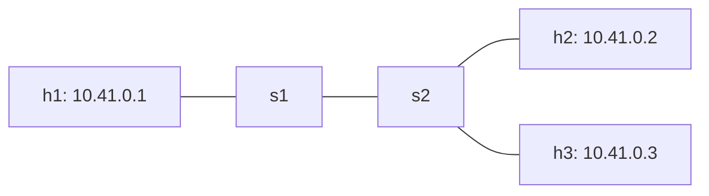
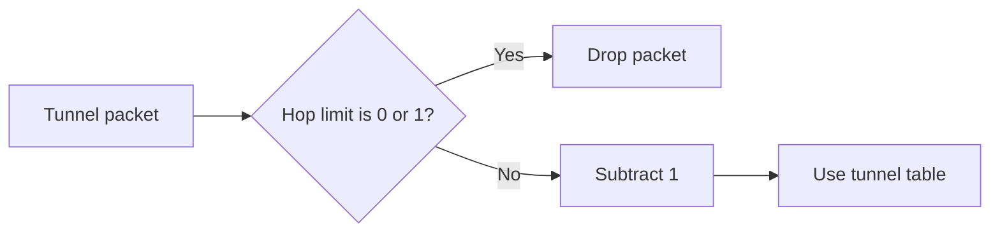

# Week 5 — Tunnel hop limit

**Student ID ending:** @@ID@@ · **Address block:** `10.41.0.0/16`

I ran the tests in the course Codespace. The network has two P4 switches and three hosts.



## 1. The loop

I changed s2's tunnel-exit-3 rule from **port 3 to port 1**. This sends the packet back to s1. The path repeats: **s1 → s2 → s1 → …**

The original program has no tunnel hop limit. Its log counts kept increasing:

| Switch | First count | Five seconds later |
|---|---:|---:|
| s1 | @@OLD_S1_FIRST@@ | @@OLD_S1_SECOND@@ |
| s2 | @@OLD_S2_FIRST@@ | @@OLD_S2_SECOND@@ |

[Commands and results](evidence/loop-before.txt)

**IPv4 TTL does not fix this program.** Tunnel forwarding does not reduce the inner IPv4 TTL. Plain IPv4 forwarding reduces TTL, but does not check for zero. It can forward TTL 0, then subtract again and wrap to 255.

## 2. My design

I added `hop_limit` after `proto_id` and `dst_id`.

| Field | Size |
|---|---:|
| `proto_id` | 16 bits |
| `dst_id` | 16 bits |
| `hop_limit` | 8 bits |

Eight bits give values **0–255** and add only **one byte**. The header grows from four to five bytes. The two existing fields stay in the same positions. Old switches still need an update because the IPv4 header now starts one byte later.

The starting value is **8**. This gives room beyond our two-switch path and keeps a loop short.



The check runs in ingress, before the tunnel table. Checking first prevents `0 - 1` from wrapping to 255. With all switches updated, 8 allows at most eight switch visits, including the visit that drops the packet.

## 3. Code changes

| File | Change |
|---|---|
| `tunnel.p4` | Add the field, check it, then subtract one before forwarding. |
| `send.py` | Add `--hops`, default 8. Accept only values 0–255. |
| `receive.py` | Read and print the remaining hop limit. |
| `tunnel_v1.p4` | Keep the finished lab program for the old/new test. |

The parser, deparser, sender and receiver use the same five-byte header. The parser reads it; the deparser writes it back. The plain IPv4 path stays the same.

## 4. Test results

All six test groups passed. The main results are:

| Test | Measured result |
|---|---|
| Tunnel packet to h2 | Arrived with hop limit **6**. |
| Tunnel packet to h3 | Arrived with hop limit **6**. |
| Starting limit 0 or 1 | Dropped at s1. |
| Starting limit 2 | Dropped at s2. |
| Starting limit 3 | Arrived at h3 with limit **1**. |
| Plain IPv4 ping | **2/2 replies; 0% loss.** |

[Delivery results](evidence/delivery.txt)

Normal tunnel delivery changes the limit **8 → 7 → 6**. The inner IPv4 TTL stays 64.

In the new loop, s1 handled the packet **@@NEW_S1@@ times** and s2 **@@NEW_S2@@ times**. The counts stopped at **eight visits** and stayed the same after five seconds. This matches the design.

[Loop results](evidence/loop-after.txt)

The [finished lab](evidence/lab-finished.txt) and [deliberate deparser failure](evidence/lab-broken-deparser.txt) were also tested.

## 5. Evaluation

### One new switch and one old switch

**Prediction saved before the test:** old s2 would still read the tunnel exit correctly. But it would read IPv4 one byte too early and could damage the packet. Only new s1 would reduce the hop limit. I expected **15 loop visits**.

**Result:** the frame reached h2, but its UDP receiver did not accept it. The old parser read the hop-limit byte `07` as the start of IPv4, instead of `45`. Its checksum update wrote to the wrong positions. The captured IPv4 protocol became `0x0d`, instead of UDP's `0x11`.

The loop stopped after **@@MIXED_S1@@ visits to s1 + @@MIXED_S2@@ to s2 = 15**. This matched the prediction. A loop with only old switches would still have no protection.

[Prediction, logs and counts](evidence/mixed.txt) · [Raw frame](evidence/mixed-frame.txt)

### Two ways to update the network safely

| Option | Benefit | Limit |
|---|---|---|
| New EtherType for the new format | Old switches reject it instead of reading it incorrectly. | New-format traffic fails on an old switch. |
| Update switches to read both formats first | Traffic can keep using the old format during the update. | Switches need extra parser logic for both formats. |

I would use the second option. First update all switches, including backup paths. Then change the senders. Remove old-format support last. A version field helps only if the receiving switch already knows how to read it.

### Data plane and control plane

Week 3's `check_paths()` finds planned loops and missing routes **before deployment**. It cannot stop a packet already looping after an unplanned table change.

The hop limit acts on **real packets**. It limits damage, but does not repair the route. A limit that is too low can also drop valid traffic. We need both checks.

### Hardware cost

Each tunnel packet gains **one byte**. The switch needs eight bits of header storage, a comparison and a subtraction. These may use extra pipeline resources. The available space for inner packets also falls by one byte at the same link MTU.

The work per packet is fixed. BMv2 tests show correct software behaviour; hardware line-rate operation still needs checks on the target chip.

## AI use

I used ChatGPT to explain logs and help write the code, test script and report. The measurements came from real runs in my Codespace.

To repeat the tests from the repository root:

```bash
python3 assignment/run_checks.py --id 4941
```
